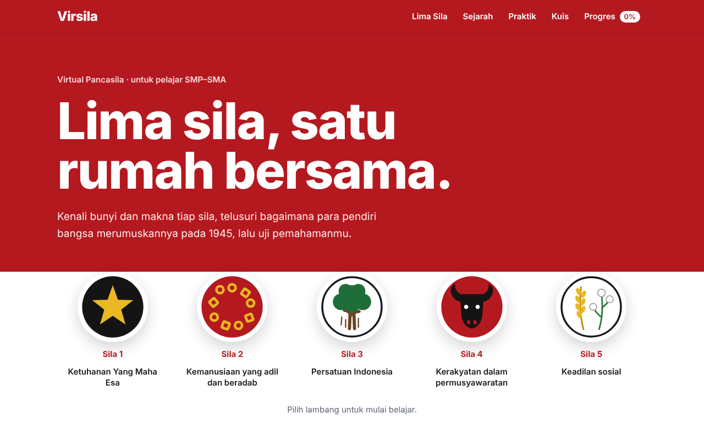
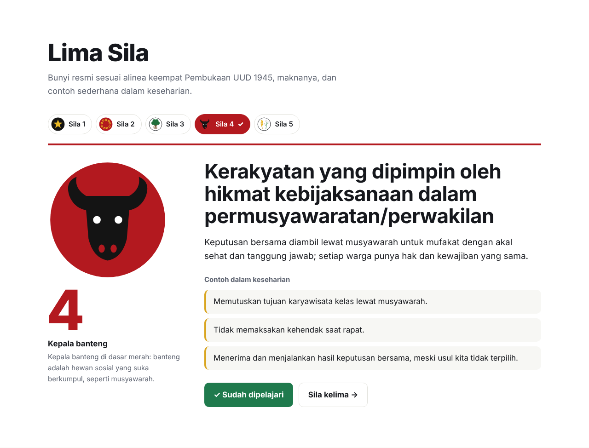
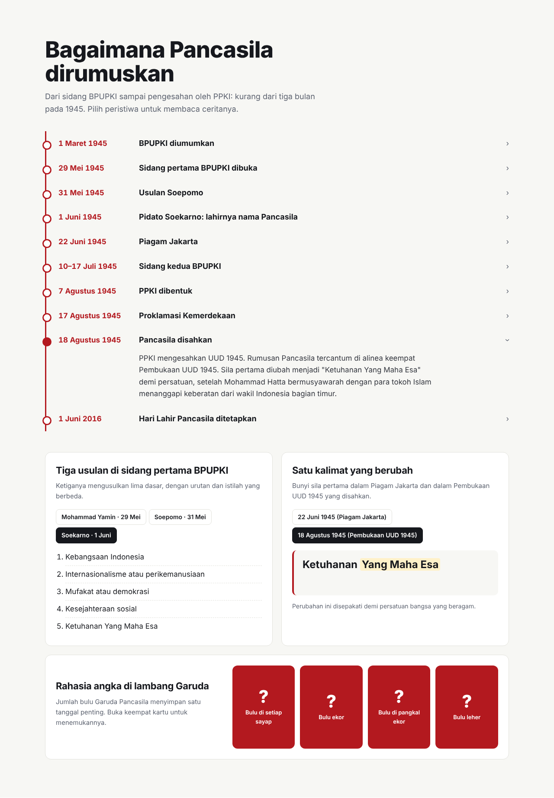
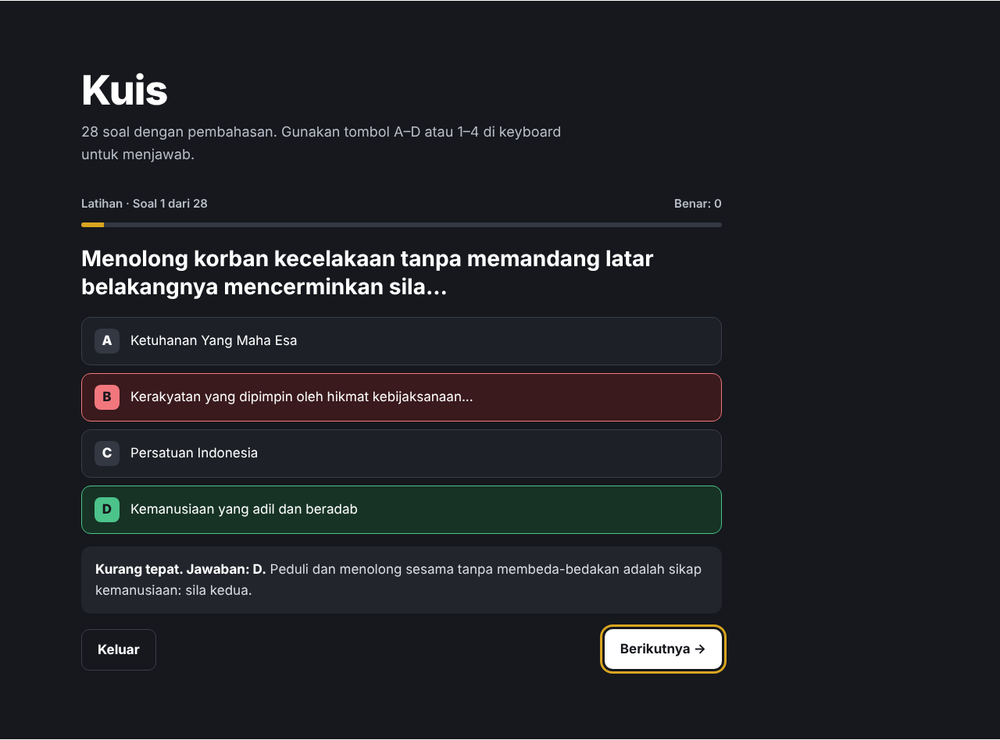
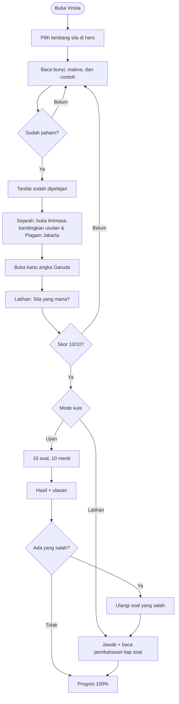
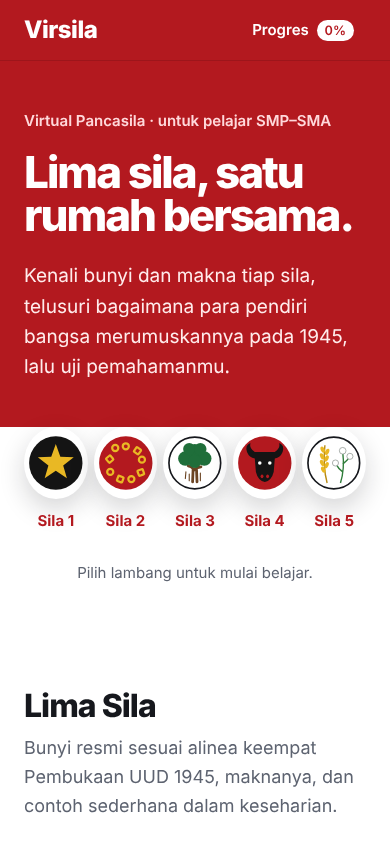

# Virsila: belajar Pancasila secara interaktif

[](https://github.com/rivaldimhr/Virsila2.0/actions/workflows/site.yml)

**Virsila** (Virtual Pancasila) adalah website belajar Pancasila untuk pelajar SMP–SMA. Kamu bisa mengenal lima sila, menelusuri bagaimana Pancasila dirumuskan pada 1945, berlatih mengenali pengamalannya dalam kejadian sehari-hari, lalu menguji pemahaman lewat kuis. Tidak perlu daftar atau login; progres tersimpan di browser.

**Coba langsung:** https://rivaldimhr.github.io/virsila/



## Yang bisa dilakukan

| Bagian | Isi | Interaksi |
|---|---|---|
| **Lima Sila** | Bunyi resmi, makna, arti lambang, 3 contoh keseharian per sila | Pilih lambang di hero atau tab (bisa dengan tombol panah), tandai "sudah dipelajari" |
| **Sejarah** | Linimasa 10 peristiwa (BPUPKI 1945 sampai Keppres 2016), usulan Yamin–Soepomo–Soekarno, perubahan sila pertama | Buka tiap peristiwa, bandingkan tiga usulan, bandingkan Piagam Jakarta dengan rumusan 18 Agustus |
| **Rahasia angka Garuda** | Jumlah bulu 17–8–19–45 | Buka empat kartu untuk menemukan tanggal Proklamasi |
| **Sila yang mana?** | 10 kejadian sehari-hari | Pilih sila yang sesuai, langsung dapat penjelasan; skor terbaik disimpan |
| **Kuis** | 28 soal dengan pembahasan | **Latihan:** semua soal, pembahasan langsung. **Ujian:** 10 soal acak, 10 menit, ulasan di akhir, dan "ulangi soal yang salah". Bisa dijawab dengan keyboard (A–D atau 1–4) |
| **Progres** | Lima target belajar dan persentase total | Nama panggilan opsional, tersimpan di browser, bisa direset |





## Diagram aktivitas



## Desain

- **Ide utama:** bendera merah putih. Hero berwarna merah di atas dan putih di bawah, dan kelima lambang sila berdiri tepat di garis pertemuannya.
- **Warna:**
  - merah `#B3191F`,
  - putih,
  - kanvas `#F7F7F4`,
  - tinta `#16181D`,
  - emas Garuda `#D9A520` untuk aksen.
- **Huruf:** [Bricolage Grotesque](https://fonts.google.com/specimen/Bricolage+Grotesque) untuk judul dan [Plus Jakarta Sans](https://fonts.google.com/specimen/Plus+Jakarta+Sans) untuk teks.
- **Lambang sila** digambar ulang secara sederhana sebagai SVG, sesuai warna dasar resmi tiap perisai.
- **Responsif sampai layar ponsel 390 px.** Fokus keyboard terlihat, dan animasi mengikuti pengaturan *reduced motion*.



## Pengujian

19 test end-to-end ([`tests/test_site.py`](tests/test_site.py), Playwright + pytest) jalan di GitHub Actions setiap ada push. Situs hanya dipublikasikan bila semua test lulus. Yang diuji:

- **Isi:**
  - setiap soal punya 4 pilihan unik, satu kunci jawaban, dan pembahasan;
  - tiap sila muncul dua kali di latihan;
  - bunyi kelima sila sama persis dengan rumusan resmi.
- **Lima sila:** klik lambang dan navigasi tab dengan tombol panah.
- **Sejarah:** linimasa, usulan, Piagam Jakarta, dan kartu Garuda.
- **Latihan "Sila yang mana?":** skor sempurna dan umpan balik jawaban salah.
- **Kuis:**
  - pembahasan langsung dan jawaban lewat keyboard;
  - ujian dengan skor 100% dan 70%;
  - "ulangi soal yang salah";
  - timer.
- **Progres:** tersimpan setelah halaman dimuat ulang dan bisa direset.
- **Tampilan:** tidak melebar di layar ponsel, dan tidak ada media berhak cipta dari versi lama.

```bash
pip install pytest playwright && python -m playwright install chromium
python -m pytest tests -v
```

## Struktur

```
index.html            halaman (satu halaman, tanpa build step)
assets/content.js     materi: lima sila, linimasa, usulan, situasi, 28 soal
assets/app.js         interaksi + progres (localStorage)
assets/style.css      gaya
tests/                test end-to-end
docs/                 screenshot README
versi-lama/           versi 2024 (login Firebase, kuis 4 soal), disimpan sebagai arsip
```

Menjalankan secara lokal: `python3 -m http.server 8000`, lalu buka http://localhost:8000/.

## Sumber materi

- Pembukaan UUD 1945, alinea keempat.
- Keputusan Presiden Nomor 24 Tahun 2016 tentang Hari Lahir Pancasila.
- UU Nomor 12 Tahun 2011, Pasal 2.
- UU Nomor 24 Tahun 2009 tentang Bendera, Bahasa, dan Lambang Negara, serta Lagu Kebangsaan.
- [BPIP](https://bpip.go.id/) dan [Kemensetneg](https://www.setneg.go.id/).

## Dari versi lama ke versi ini

Versi 2024 adalah proyek kelompok dan masih ada di folder [`versi-lama/`](versi-lama/). Masalah yang diperbaiki:

- **Login:** wajib login lewat Firebase tim, sehingga situs tidak bisa dipakai bila proyek Firebase itu mati. Sekarang tanpa login.
- **Materi dan kuis:**
  - Kuis hanya berisi **4 soal**. Dua di antaranya bermasalah: soal tentang kedudukan Pancasila "dalam hubungannya dengan UUD 1945" tidak menyediakan pilihan "dasar negara", dan satu soal lain punya beberapa jawaban yang bisa dibenarkan.
  - Kedua soal yang baik dipertahankan, lalu bank soal diperluas menjadi 28 soal dengan pembahasan.
  - Materi sejarah hanya satu paragraf. Sekarang ada linimasa dan perbandingan usulan.
- **Media berhak cipta:** video klip musik, poster film, dan beberapa gambar dari internet (52 MB video) dihapus. Sebagai gantinya, halaman menautkan sumber resmi.
- **Error dan tampilan:** dua error JavaScript di halaman diperbaiki, dan tampilan kini responsif untuk ponsel.
- **Ukuran repo:** folder Font Awesome yang ikut di-commit dihapus. Ikon diganti SVG buatan sendiri.

Repo lain dari proyek yang sama (`VIRSILA`, `virsila_2`, `tubeswebsite`, `WebPancasila`) adalah versi-versi sebelumnya dan bisa diarsipkan.
